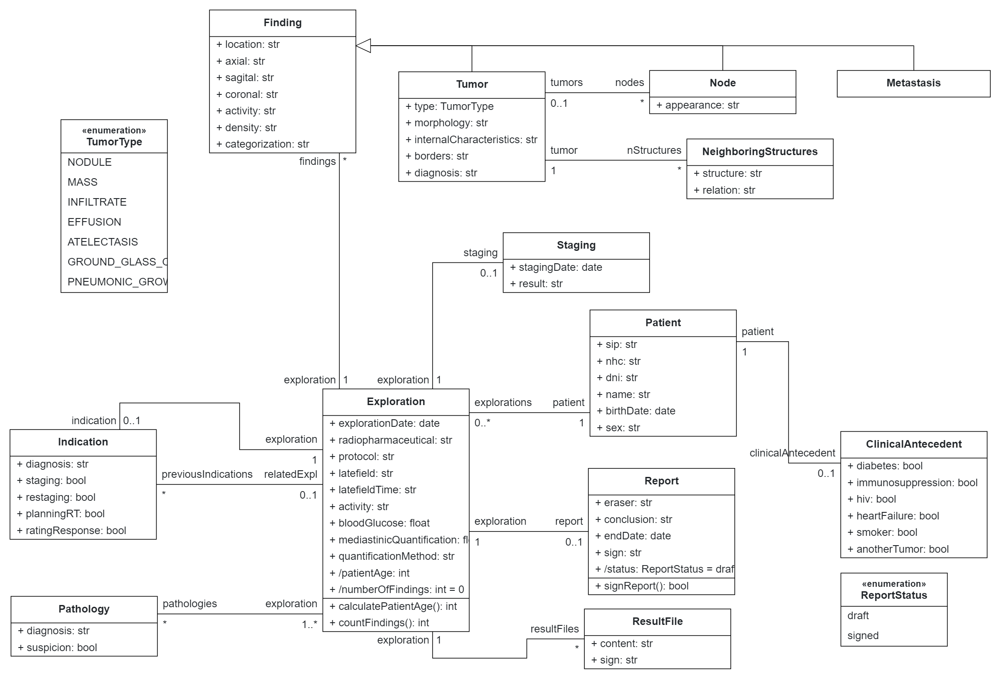

# Low-Code Model - Nuclear Medicine for Lung Cancer

This directory contains the model used as input for the pure low-code development process of a `CRUD web application` for the Nuclear Medicine for Lung Cancer case study.

The model is specific to this application and is not provided as an input to the pure agentic development process. For the hybrid development process, the corresponding model is produced by the modeling agent from the [natural-language requirements](../nl-requirements).

## About the Model

At the heart of the model is the `Exploration`, which represents a PET/CT study performed on a `Patient`. It contains the scan's acquisition details, such as the radiopharmaceutical, protocol, late acquisition time, and blood glucose. An `Exploration` may have an `Indication`, describing the reason for the study, such as diagnosis, staging, restaging, or treatment planning. An exploration can also refer to previous indications, keeping the patient's diagnostic history connected over time.

The model also records `Pathology` entries. Each `Pathology` is linked to the `Patient` who potentially suffers from it, and it may also be linked to several `Explorations` that help confirm it.

An `Exploration` can reveal `Finding`s, representing relevant observations in the images. These can be specialized as `Tumor`, `Node`, or `Metastasis`. A `Tumor` contains additional information, such as its type, morphology, borders, and a diagnosis. It can also be related to nearby `Node`s and `NeighboringStructures`. Based on these findings, the study may produce a `Staging` and a `Report`. The `Exploration` may also produce any number of `ResultFile`s.

The `Patient` side of the model stores relevant clinical background. A `ClinicalAntecedent` represents comorbidities or risk factors, such as diabetes or smoking history.

## Dynamic Calculations

Some values are not entered by the user but calculated by the application. They are modeled as derived attributes, together with the methods that compute them:

| Class | Derived attribute | Method | Behavior |
|---|---|---|---|
| `Exploration` | `patientAge: int` | `calculatePatientAge(): int` | Number of full years between the patient's `birthDate` and the exploration's `explorationDate`. |
| `Exploration` | `numberOfFindings: int` (default `0`) | `countFindings(): int` | Number of `Finding`s revealed by the exploration. |
| `Report` | `status: ReportStatus` (default `draft`) | `signReport(): bool` | Refused (`False`) if the report is already signed or has no `conclusion` or `sign`; otherwise sets `status` to `signed` and `endDate` to today, and returns `True`. |

The `ReportStatus` enumeration has two literals: `draft` and `signed`.

## Opening the Project

1. Go to [BESSER Web Editor](https://editor.besser-pearl.org/)
2. Create a new Project
3. Import [Nuclear_Medicine_for_Lung_Cancer.json](model.json)
