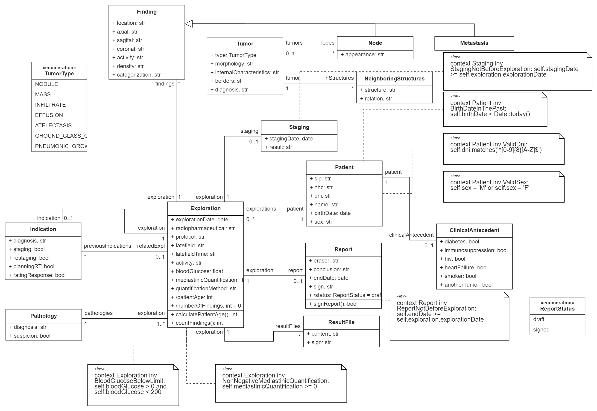

# Low-Code Model - Nuclear Medicine for Lung Cancer

This directory contains the model used as input for the pure low-code development process of a `web application with validation and business rules` for the Nuclear Medicine for Lung Cancer case study.

The model is specific to this application and is not provided as an input to the pure agentic development process. For the hybrid development process, the corresponding model is produced by the modeling agent from the [natural-language requirements](../nl-requirements).

## About the Model

This model reuses the class diagram of the [first variation](../../1-CRUD-and-dynamic-calculations/low-code-model) unchanged: an `Exploration` (a PET/CT study) is performed on a `Patient`, has an `Indication`, reveals `Finding`s (specialised as `Tumor`, `Node` and `Metastasis`), and produces a `Staging`, a `Report` and `ResultFile`s. It also keeps the same dynamic calculations: `calculatePatientAge()` and `countFindings()` on `Exploration`, and `signReport()` on `Report` (with its `ReportStatus`).

On top of that structure, this variation adds validation and business rules expressed as OCL invariants, each one in its own constraint box:

| Context | Invariant | Rule |
|---|---|---|
| `Patient` | `ValidDni` | The DNI is exactly eight digits followed by one uppercase letter (`^[0-9]{8}[A-Z]$`). |
| `Patient` | `ValidSex` | The sex is either `M` or `F`. |
| `Patient` | `BirthDateInThePast` | The birth date is earlier than today. |
| `Exploration` | `BloodGlucoseBelowLimit` | The blood glucose is greater than 0 and lower than 200. |
| `Exploration` | `NonNegativeMediastinicQuantification` | The mediastinal quantification is never negative. |
| `Staging` | `StagingNotBeforeExploration` | The `stagingDate` is not earlier than the `explorationDate` of its exploration. |
| `Report` | `ReportNotBeforeExploration` | The report's `endDate` is not earlier than the `explorationDate` of its exploration. |

The generated application must reject any create or update operation that violates one of these invariants.

## Opening the Project

1. Go to [BESSER Web Editor](https://editor.besser-pearl.org/)
2. Create a new Project
3. Import [Nuclear_Medicine_for_Lung_Cancer.json](model.json)
