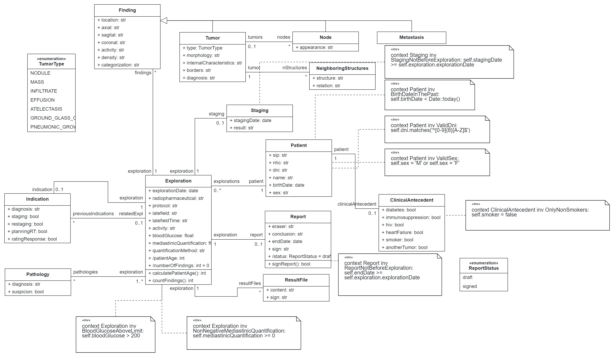

# Low-Code Model - Nuclear Medicine for Lung Cancer

This directory contains the model used as input for the pure low-code development process of a `web application with edge cases` for the Nuclear Medicine for Lung Cancer case study.

The model is specific to this application and is not provided as an input to the pure agentic development process. For the hybrid development process, the corresponding model is produced by the modeling agent from the [natural-language requirements](../nl-requirements).

## About the Model

This model starts from the [second variation](../../2-validation-and-business-rules/low-code-model) (same classes, associations and OCL invariants) and introduces rules that deliberately go against the usual conventions of the domain. Their purpose is to check whether each development approach follows the specification as written instead of falling back on what is "normally" expected. The rules are also listed in [non-conventions.txt](non-conventions.txt).

| Context | Invariant | Change with respect to variation 2 |
|---|---|---|
| `Exploration` | `BloodGlucoseAboveLimit` | **Replaces** `BloodGlucoseBelowLimit`: the blood glucose must now be **greater than 200**, the opposite of the conventional rule. |
| `ClinicalAntecedent` | `OnlyNonSmokers` | **New**: a clinical antecedent can never record the patient as a smoker (`self.smoker = false`), which is unusual for a lung cancer service. |

The other invariants (`ValidDni`, `ValidSex`, `BirthDateInThePast`, `NonNegativeMediastinicQuantification`, `StagingNotBeforeExploration` and `ReportNotBeforeExploration`) are kept unchanged.

## Opening the Project

1. Go to [BESSER Web Editor](https://editor.besser-pearl.org/)
2. Create a new Project
3. Import [Nuclear_Medicine_for_Lung_Cancer.json](model.json)
